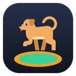

# Pet Assist

**Garde ton chien hors du canapé (ou de la table, du lit…) avec ta propre voix.** Un projet MCF Studio.

Pet Assist regarde ta caméra, reconnaît **le chien** (les chats sont ignorés) et, quand il reste dans une
zone interdite, ton enceinte lui dit ta phrase (« Au panier ! ») en boucle jusqu'à ce qu'il aille à sa place.

## ⬇️ Télécharger

**[Pet Assist pour Windows (dernière version)](https://github.com/MCF-Studio/pet-assist/releases/latest)**
— fichier `Pet-Assist_x.y.z_x64-setup.exe`, Windows 10/11 64 bits, sans droits administrateur.

## Ce que ça fait

- 🔴 **Zones rouges** (interdites) et 🟢 **zones vertes** (sa place), autant que tu veux, dessinées à la
  souris sur l'image de la caméra, chacune avec **son nom et sa phrase**.
- 🎙️ Ta **voix enregistrée** au micro, un mémo vocal du téléphone, ou une voix de synthèse.
- 🐕 Seul le chien déclenche, **jamais les chats** — même la nuit en infrarouge.
- 📷 N'importe quelle caméra avec un flux **RTSP** (Dahua, Hikvision, EZVIZ, Tapo, Reolink…), ou la fenêtre
  de l'appli de ta caméra sur le PC.
- 🔊 Enceinte **Bluetooth** gardée éveillée 24 h/24 pour que la phrase sorte toujours en entier.
- 📊 Journal avec une photo à chaque rappel, statistiques sur 14 jours.
- 📱 Accessible depuis le **téléphone** sur le même wifi.
- Tourne discrètement près de l'horloge, peut démarrer avec Windows.

## Démarrage rapide

1. Installe, puis ouvre **Réglages → Source vidéo** : colle l'adresse RTSP de ta caméra (des exemples par
   marque sont dans l'appli) ou choisis la fenêtre de l'appli de ta caméra.
2. **Réglages → Enceinte** : choisis ton enceinte.
3. **Zones** : « + Zone rouge » sur le canapé, « + Zone verte » sur le panier, écris ou enregistre la phrase.

Détection d'objets : modèle **YOLOX** (Megvii, Apache-2.0). Licences des composants : [LICENCES-TIERS.txt](LICENCES-TIERS.txt).

© MCF Studio
